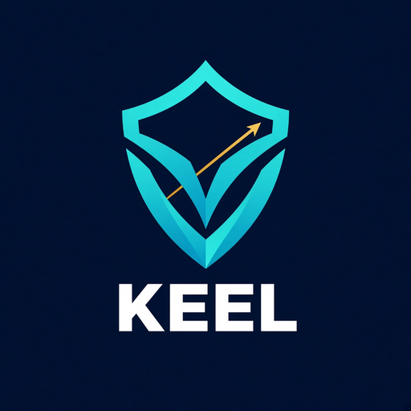
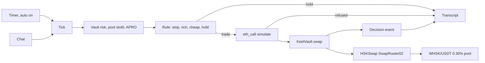

<p align="center"></p>

# Keel

**Demo video (2:16, recorded live on HSK mainnet):** https://youtu.be/Y8ZGB-Qex4M

Keel is a Track A entry for the [HSK Chain Horizon Hackathon · Seoul](https://dorahacks.io/hackathon/hskchainseoul/detail). It is an autonomous trading agent for the WHSK/USDT pool on HSKSwap. With `auto on` it reads the pool and the APRO HSK/USD oracle on a timer, decides buy, sell or hold, and sends the swap itself. Nobody approves each trade. The only address that can swap is a vault, and the vault enforces the trade cap, the slippage floor, the cooldown, the inventory cap and the daily realized-loss stop. People keep the off switch: `auto off`, `pause`, and limits that can only get tighter.

Submission closes 3 Dec 2026 04:00 UTC.

**Mainnet vault:** [`0x8980296BAe193A359937ac873f8E6759C289646d`](https://hsk.blockscout.com/address/0x8980296BAe193A359937ac873f8E6759C289646d) on HSK Chain (chain id 177). Source verified on Blockscout as a full match, and an exact match on [Sourcify](https://sourcify.dev/server/v2/contract/177/0x8980296BAe193A359937ac873f8E6759C289646d). Three swaps were decided and sent by the loop on mainnet with no approve step; see [Autonomous run on mainnet](#autonomous-run-on-mainnet).

## How it works

### The rule

`src/lib/strategy.ts`. One pair, one reference, three ways out of HOLD.

- **Reference.** APRO HSK/USD while its last print is inside the feed heartbeat. APRO re-prints on a price move or every 24 hours, so the cutoff is 25 hours. If APRO is older, the mean of the last pool reads, after at least four.
- **Premium** = (pool − reference) / reference, in bps.
- **Stop.** If the vault holds a tracked position and the pool is 150 bps under its average cost, sell. Stops never go to the language model.
- **Rich.** Premium ≥ band: sell WHSK, up to the per-trade cap and the vault balance.
- **Cheap.** Premium ≤ −band: buy WHSK, up to the cap and the USDT balance. Half size once half of the daily loss budget is used. No buy once it is spent. Sized down to stay under the inventory cap.
- **Hold** otherwise, with the numbers.

The standard band is 60 bps. The pool fee is 0.30% each way, so a smaller gap would not pay for the round trip. `auto demo` switches to a 10 bps band for a quiet pool. That is a demo setting and the desk says so. The vault limits do not change with the profile.

### The loop

`src/lib/auto.ts`, `src/lib/autopilot.ts`, `src/lib/runner.ts`. `auto on [seconds]` starts it, every 90 seconds by default and never faster than 15. Each tick:

1. Reads `KeelVault.risk()` and the agent's HSK balance. The vault's balances, cost basis, day loss and limits replace the desk's copy, so the desk never trades on a stale mirror.
2. Stops the loop if the agent has under 0.15 HSK for gas, or if the vault is paused.
3. Reads the pool `slot0` and APRO `latestRoundData`.
4. Holds if the vault cooldown has time left, and looks again when it clears.
5. Applies the rule. A hold is written to the transcript with its reason. The same hold twice in a row becomes one line, `Auto #4–#9 · HOLD`.
6. For a trade, simulates `swap` with `eth_call`, then sends it from the agent key. The transcript gets the size, the rule's reason, the amount received and the Blockscout link. The vault emits a `Decision` event with the reason text.

Refusals are named. `Cooldown` and `DailyLoss` are expected and only move the schedule. Any other refusal or error counts as a failure. The wait doubles each time, up to 15 minutes, and the third failure in a row turns the loop off. After a restart the loop is off until a person types `auto on`.

If `LLM_API_KEY` is set, the model writes the note and may skip or halve a non-stop trade. It cannot raise the size, flip the side or cancel a stop. With no key the note is the rule.

### People

- `auto off` stops the loop. `pause` is an owner transaction: the vault refuses every swap, and auto turns off. `resume` unpauses and leaves auto off.
- `max trade 1`, `daily loss 3`, `slippage 0.5%`, `cooldown 120` go to `KeelVault.tighten` on chain. Loosening, for example `max trade 3`, is refused before anything is sent.
- The manual flow is still there: `check the pool` or `buy 2` makes a proposal, and `approve` sends it.

The header shows Auto on, off or stopped, with the seconds to the next decision. The book panel shows the strategy profile, decisions, trades and agent gas.



## Official HSK products

| What | Value | Source | Checked |
| --- | --- | --- | --- |
| Mainnet RPC, chain id 177 | `https://mainnet.hsk.xyz` | [Network info](https://docs.hskchain.net/docs/Build-on-HashKey-Chain/network-info) | `eth_chainId` = 177 |
| Mainnet explorer | `https://hsk.blockscout.com` | same page | HTTP 200 |
| Testnet RPC, chain id 133 | `https://testnet.hsk.xyz` | same page | `eth_chainId` = 133 |
| Testnet explorer | `https://testnet-explorer.hskchain.net` | same page | used for links |
| Faucet | docs name `https://faucet.hsk.xyz`, which redirects to `https://faucet.hskchain.net/faucet` | [Faucet](https://docs.hskchain.net/docs/Build-on-HashKey-Chain/Tools/Faucet) | the claim button asks for reCAPTCHA. The testnet owner and agent used below were funded with 0.1 HSK each outside this workspace |
| Mainnet WHSK | `0xB210D2120d57b758EE163cFfb43e73728c471Cf1` | [Token contracts](https://docs.hskchain.net/docs/Build-on-HashKey-Chain/Token-Contracts) | `symbol()` = WHSK, 18 decimals |
| Mainnet USDT | `0xf1b50ed67a9e2cc94ad3c477779e2d4cbfff9029` | same page | `symbol()` = USDT, 6 decimals |
| HSKSwap mainnet factory | `0x972cA9D1662F5e029cD18327D29026532E84c742` | `@hskswap/sdk-core@1.0.3` `HASHKEY_MAINNET_ADDRESSES` | `router.factory()` matches |
| HSKSwap mainnet SwapRouter02 | `0x2c16f75b95Cf1390c328aB70e2CEE7f4b80bD8F3` | same SDK map | `WETH9()` is mainnet WHSK |
| HSKSwap mainnet QuoterV2 | `0x603f70466fDdbE3F238220B9a74FFF419a2BbFDD` | same SDK map, field `quoterAddress` | `quoteExactInputSingle` returned a quote |
| Mainnet WHSK/USDT 0.30% pool | `0x4ff515761864e7838B0AdB8b5b2B8B7A068905dC` | `factory.getPool(WHSK, USDT, 3000)` | token0 WHSK, token1 USDT, fee 3000 |
| HSKSwap testnet factory | `0x2dC2c21D1049F786C535bF9d45F999dB5474f3A0` | SDK `HASHKEY_TESTNET_ADDRESSES` | `router.factory()` matches |
| HSKSwap testnet SwapRouter02 | `0xa6914E66690c6794244B5f66a09eAEbf66254237` | same | `WETH9()` is testnet WHSK |
| HSKSwap testnet QuoterV2 | `0x73820d9eE5Bf1BfcD429580320FC7A374E8fa1cC` | same | code present |
| Testnet WHSK | `0xCA8aAceEC5Db1e91B9Ed3a344bA026c4a2B3ebF6` | SDK `WETH9` token list | `symbol()` = WHSK |
| Testnet pool USDT | `0x98B6173A8B7DFc52ce8bc88f1184a918A1CCaa4F` | `getPool` token0, not the docs token page | 18 decimals, `symbol()` = USDT |
| Testnet WHSK/USDT 0.30% pool | `0xc076FB478b77633736738579c7f48D2539604a50` | `getPool(..., 3000)` | fee 3000. Price is not the mainnet price |
| APRO HSK/USD | `0x86CE42c1b714149Dc3A7b17169EF67b5F78A224b` | [Oracles](https://docs.hskchain.net/docs/Build-on-HashKey-Chain/Tools/Oracle) prints a 38-hex string | `description()` = HSK/USD, 8 decimals. The docs string is one byte short; this is the contract that answers |
| Wallet parameters | RPC, chain id, HSK, explorer above | [Wallet](https://docs.hskchain.net/docs/Build-on-HashKey-Chain/Tools/Wallet) | OKX Wallet is the documented path |
| Safe | `https://safe-transaction-hashkey.safe.global` | [Safe](https://docs.hskchain.net/docs/Build-on-HashKey-Chain/Tools/Safe) | not used by Keel. `transferOwnership` can point at one later |

HSP is Track B. Keel does not call it.

Secondary RPC host `hsk-mainnet.hashkey.com` did not resolve from this environment. It is not in the network-info page, so Keel does not use it.

Gas observed on 20 Nov 2026: mainnet about 500 gwei, testnet about 1 gwei. A vault deploy is on the order of a couple million gas, so a few dollars of HSK covers mainnet gas and the tiny inventory. That is not a promise about the HSK price.

## Run locally

Node 22 and [Foundry](https://book.getfoundry.sh/) are enough.

```bash
cd contracts && ./install-forge-std.sh && forge test --offline
cd ..
npm ci
cp .env.example .env
npm test
npm run dry-run
npm run dev
```

The desk is at [http://127.0.0.1:4317](http://127.0.0.1:4317).

Commands: `auto on`, `auto on 30`, `auto off`, `auto demo`, `auto standard`, `auto status`, `check the pool`, `worked example`, `approve`, `reject`, `status`, `max trade 1`, `daily loss 3`, `slippage 0.5%`, `cooldown 120`, `pause`, `resume`, `buy 2`, `sell 0.01`, `reset`. Paper mode reads live mainnet prices and fills a paper book, including with `auto on`.

`npm test` runs 34 unit tests with no network. They cover the rule (rich, cheap, band, stale APRO, warm-up, stop, daily loss halving and blocking, inventory cap), the loop guard (backoff, three-strike stop, cooldown and daily-loss refusals that do not count, pause), and full ticks against a fake vault: a trade with no approve, a logged hold, low gas, a paused vault, repeated refusals, on-chain limits replacing the local copy, paper autonomy, and the chat controls.

`max trade` and the other limit commands only move the paper policy safer. Raising a cap is refused. On testnet or mainnet, the same command is sent to `tighten` when `OWNER_PRIVATE_KEY` and `VAULT_ADDRESS` are set.

## Contracts

```bash
cd contracts
./install-forge-std.sh
forge test --offline
```

18 tests. They cover the per-trade cap, the spot slippage floor, the router minimum, cooldown, inventory, pause, withdraw, the agent/owner split, decision replay, a realized loss that blocks the next buy, the next-day reset, and tighten versus setPolicy.

Deploy scripts:

```bash
# testnet, after the owner wallet has testnet HSK
cd contracts
set -a
source ../.env
set +a
./deploy/testnet.sh
```

`PRIVATE_KEY` is the owner. `AGENT` is the agent address, not the key. The script does not print the key. Mainnet refuses to broadcast unless `CONFIRM_MAINNET=yes`. See `submission/MAINNET_STEPS.md`.

| Network | KeelVault | Status |
| --- | --- | --- |
| HSK testnet, chain 133 | [`0x8414702dD9bd6C0938Be758E96cF1C6Ec7bF32B5`](https://testnet-explorer.hskchain.net/address/0x8414702dD9bd6C0938Be758E96cF1C6Ec7bF32B5) | source verified, full match |
| HSK mainnet, chain 177 | [`0x8980296BAe193A359937ac873f8E6759C289646d`](https://hsk.blockscout.com/address/0x8980296BAe193A359937ac873f8E6759C289646d) | source verified, full match. Sourcify exact match |

The verified testnet vault was deployed in [`0x9370b5a0…725f48`](https://testnet-explorer.hskchain.net/tx/0x9370b5a0f293cba0cd6157120d5a9b997a8cbd008dddfac9112520aa9d725f48). Owner `0x54DE9EfF520b7025086D59c089Cd192F7a6372e4`. Agent `0x2932524A7679164472856428312097bdc02d734a`. Sourcify reports an exact match: https://sourcify.dev/server/v2/contract/133/0x8414702dD9bd6C0938Be758E96cF1C6Ec7bF32B5

A guarded sell of 0.001 WHSK on that vault: [`0x5594f366…62a419`](https://testnet-explorer.hskchain.net/tx/0x5594f3666fb5c9ee98a7e1c5a58dedb110d0f94dc2a6cab9603e0cd84162a419). The receipt has a `Decision` event. Output was about 0.054 test USDT. That price is the testnet pool, near 54, not the mainnet price.

The explorer gateway returns HTTP 413 above about 100KB. The first vault, [`0x8C4c3769…44EC9`](https://testnet-explorer.hskchain.net/address/0x8C4c3769BC08425730d95A84F4709bbf34e44EC9), imported OpenZeppelin and its standard JSON was 114KB, so the explorer could not take it. Sourcify still has an exact match for that address, and its two Decision sells remain valid. The current vault keeps multiplication, approval, and the reentrancy lock in small local files. The standard JSON is about 19KB. `contracts/deploy/verify.sh` submits that JSON to Sourcify and to Blockscout. The form field has to be `files[0]`. A single field named `files` is not read as the JSON. The same script is what mainnet should run. The record is `contracts/deployments/133.json`.

Testnet caps in `deploy/testnet.sh`: 0.05 test USDT in, 0.002 WHSK in, 1% slippage, 30s cooldown, 0.2 test USDT daily realized loss, 0.02 WHSK inventory. Mainnet caps: 5 WHSK in, 2 USDT in, 1% slippage, 60s cooldown, 5 USDT daily realized loss, 50 WHSK inventory.

After a testnet deploy, a guarded sell:

```bash
MODE=testnet VAULT_ADDRESS=0x... OWNER_PRIVATE_KEY=0x... AGENT_PRIVATE_KEY=0x... npm run testnet-swap
```

The script wraps 0.001 HSK into the vault and sells that WHSK through `swap`. It does not touch mainnet.

## On mainnet

Deployed 21 Nov 2026 with `contracts/deploy/mainnet.sh` and verified with `contracts/deploy/verify.sh`. The record is `contracts/deployments/177.json`.

| Step | Transaction |
| --- | --- |
| Deploy KeelVault (2,067,747 gas) | [`0x386afa2d…a05f4`](https://hsk.blockscout.com/tx/0x386afa2dba142422438d44f847c61c74a926812e4e67c8df19688736a7ca05f4) |
| Owner wraps 8 HSK into the vault | [`0x9fdbaa3e…06e95`](https://hsk.blockscout.com/tx/0x9fdbaa3e584344a31f1d2a92eb034a7c544f8d05dfa153ad16b6c609d9b06e95) |
| Chat `sell 5`, `approve`: 5 WHSK for 0.404297 USDT | [`0x3be3acda…9f702`](https://hsk.blockscout.com/tx/0x3be3acda6b866ea83bb81c8cc533a45646af2fbaa737cbc704f9fd2667b9f702) |
| Chat `buy 0.3`, `approve`: 0.3 USDT for 3.6879 WHSK | [`0x2d86b4e5…3d26b`](https://hsk.blockscout.com/tx/0x2d86b4e5a9f5e6090fc1a08827c33a965cf045208dab8b70ced2d84af3b3d26b) |

Both swaps were sent by the agent key from the desk in `MODE=mainnet`, and each receipt has a `Decision` event with the reason. Owner `0x35D6cAbC30d0a1ee1B8d666DcC9944727a7145D2`. Agent `0x8745a069574F6cD367d9877F04715617A77B7a6d`.

What the vault refused in the same session, with no transaction broadcast:

- `sell 6`, `approve`: `Cap(6000000000000000000, 5000000000000000000)`. The per-trade cap is 5 WHSK.
- `buy 0.3`, `approve` right after the sell: `Cooldown(readyAt)`. The cooldown is 60 seconds.
- `max trade 3`: the desk refuses it, because 3 USDT is looser than the 2 USDT cap.

A refusal shows up at gas estimation, so it costs nothing. The desk prints the vault error by name.

HSK was about 0.081 USDT in the pool that day, so a 5 WHSK trade is about 0.40 USDT. A 2 USDT buy needs more USDT in the vault than these trades produced. The sizes are tiny on purpose.

## Autonomous run on mainnet

21 Nov 2026, desk in `MODE=mainnet`, standard profile (60 bps band), `auto on 20`. APRO HSK/USD was 0.08042, printed about 13 hours earlier and inside its 24 hour heartbeat. The pool was 0.08110, 85 bps over. That is past the band, so the rule sold. Nobody typed approve.

| Decision | Transaction |
| --- | --- |
| Loop sells 5 WHSK for 0.404297 USDT | [`0xb45addd…9aa4a`](https://hsk.blockscout.com/tx/0xb45adddf2c93bc020a27c65bb6d039102e8d77234d2283ba96a726f24449aa4a) |
| Loop sells 1.6879 WHSK for 0.136483 USDT | [`0x28cf10c…9f9ca`](https://hsk.blockscout.com/tx/0x28cf10c5ad83b81a0a23d3263c24453d5b225969dd18fd4a077093de09c9f9ca) |
| Loop sells 1.2 WHSK for 0.097031 USDT, in the demo video | [`0x7dbf7c2…74d72`](https://hsk.blockscout.com/tx/0x7dbf7c2b78cb1e723e56a7cd0c63ac7e0302efd633a43979da6dac7eb6474d72) |
| Owner `pause` from the chat, auto turns off | [`0x8000e17…40e49`](https://hsk.blockscout.com/tx/0x8000e177a19ea380b514a14e0dec747ac02b914762fd3c3e4fc214f2bd040e49), [`0x2a0356f…027e6`](https://hsk.blockscout.com/tx/0x2a0356f85d513e58eb98e8295d176076223efc68bb40c5c33e3f132dfea027e6) |
| Owner `resume` | [`0x47120aa…b34fd`](https://hsk.blockscout.com/tx/0x47120aa79b132feab0ee68fc23ad5c663d0ebaeb6484ae70f94da1739aeb34fd), [`0xa009caa…e1838`](https://hsk.blockscout.com/tx/0xa009caa8ef8d68b59c26a2df9ddae00917f6b0f37780605b80441dc7c1ce1838) |

Each swap was sent by the agent key and has a `Decision` event whose reason starts with `auto:` and gives the pool, the APRO print, its age and the band. Between the swaps the loop logged holds: the cooldown, then "the pool is rich, but there is no WHSK to sell" once the vault was empty. `auto on` was refused while the vault was paused. `max trade 3` was refused before anything was sent.

Two things the run caught, both fixed and covered by tests:

- In one run the first attempt came back `Replay()`. Decision ids were derived from the desk's proposal id, which restarts at `k1` when the book is reset, so the id had been used by an earlier run. The vault refused it, the loop counted one failure, waited, and the next attempt traded. Decision ids now include the vault address and the proposal's expiry second.
- One tick held on a cooldown with 2 seconds left, because the next tick was scheduled from the start of the previous tick rather than after the swap was mined. The schedule is now set when the tick ends.

Total gas for this run, including a 1 HSK agent top-up and a 1.2 HSK wrap into the vault: about 0.38 HSK, at 500 gwei. The vault ended with 0 WHSK and 0.742108 USDT.

## Deploy the desk

The app is a Next.js app and can be deployed with `npx vercel`. Leave `MODE=paper` and leave the key empty. Vercel’s filesystem is ephemeral, so the paper book resets when the instance sleeps. That is fine for a demo. Do not put a private key in the Vercel project for a public URL.

## Security

- The agent can call `swap` and nothing else. Withdraw, pause, `setPolicy`, `tighten`, `setAgent`, and `transferOwnership` are owner-only.
- `swap` approves the router for the exact input and clears the allowance after the call.
- `amountOutMin` must be at least the fee-adjusted spot, minus the slippage cap. The cap cannot be set above 5%. Spot is `slot0`, so a price pushed inside one block can move the floor. Keel does not use a TWAP. Sizes stay tiny for that reason.
- The daily figure is realized loss of quote inventory against cost basis. Buys stop once it is reached. Sells still go through, so a stop is not trapped. It resets on the UTC day.
- The first swap is not cooled down. `lastSwapAt` starts at zero.
- A stop flag in the event is a label. It does not bypass a cap.
- Fee-on-transfer tokens are rejected because the input balance must fall by exactly `amountIn`.
- Paper fills use spot after the fee and ignore price impact. A live swap still has to clear the router minimum.
- Testnet pool prices are not dollar prices. Do not read testnet P&L as a result.
- The loop simulates every swap with `eth_call` before it signs, stops under 0.15 HSK of agent gas, stops after three failures in a row, and is off after a restart.
- Do not run mainnet mode on a public host. The desk has no login, and anyone who can reach it can type `auto on` or `pause`.
- Keys stay in `.env`. `.env.example` has none.

## Layout

- `contracts/` Foundry vault and tests. forge-std is for the tests. The vault source does not import OpenZeppelin, so the explorer can take the standard JSON.
- `src/lib/strategy.ts` the rule. `auto.ts` one autonomous tick. `autopilot.ts` backoff and stop rules. `runner.ts` the timer and the queue that keeps chat and ticks from overlapping. `live.ts` vault reads, simulate-then-send, owner calls. Also the paper ledger, parser, LLM note and pool reader
- `src/app/` chat desk
- `submission/` BUIDL text, demo script, mainnet steps
