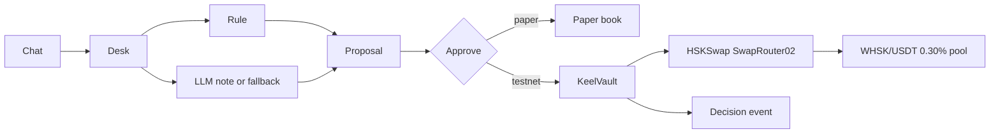

# Keel

Keel is a Track A entry for the [HSK Chain Horizon Hackathon · Seoul](https://dorahacks.io/hackathon/hskchainseoul/detail). It is a WHSK/USDT agent for HSKSwap. The agent can read the pool and explain a trade. The only address that can swap is a vault, and the vault enforces the size, slippage, cooldown, inventory, and daily realized-loss limits.

Submission closes 3 Dec 2026 04:00 UTC. This repo does not register the BUIDL and does not touch a mainnet wallet.

## How it works

The book starts in paper mode with 100 USDT and sends nothing. `check the pool` reads the live HSKSwap pool. A buy is proposed only when the pool is at least 50 bps under a reference: APRO HSK/USD when that print is under six hours old, otherwise the mean of the earlier reads. A sell is proposed when the gap closes, when price is 150 bps under the entry, or when the position is six hours old. Stops are not sent to the language model.

If `LLM_API_KEY` is set, the model may only take, skip, or halve a non-stop entry, and it writes the note. With no key, the note is the rule. Nothing fills until you reply `approve`.

On testnet, approve sends `KeelVault.swap`. The contract builds the `exactInputSingle` call itself. The agent key cannot withdraw, cannot pick another router, and cannot set a minimum below the spot floor.



## Official HSK products

| What | Value | Source | Checked |
| --- | --- | --- | --- |
| Mainnet RPC, chain id 177 | `https://mainnet.hsk.xyz` | [Network info](https://docs.hskchain.net/docs/Build-on-HashKey-Chain/network-info) | `eth_chainId` = 177 |
| Mainnet explorer | `https://hsk.blockscout.com` | same page | HTTP 200 |
| Testnet RPC, chain id 133 | `https://testnet.hsk.xyz` | same page | `eth_chainId` = 133 |
| Testnet explorer | `https://testnet-explorer.hskchain.net` | same page | used for links |
| Faucet | docs name `https://faucet.hsk.xyz`, which redirects to `https://faucet.hskchain.net/faucet` | [Faucet](https://docs.hskchain.net/docs/Build-on-HashKey-Chain/Tools/Faucet) | the claim button asks for reCAPTCHA. The testnet owner and agent used below were funded with 0.1 HSK each outside this workspace |
| Mainnet WHSK | `0xB210D2120d57b758EE163cFfb43e73728c471Cf1` | [Token contracts](https://docs.hskchain.net/docs/Build-on-HashKey-Chain/Token-Contracts) | `symbol()` = WHSK, 18 decimals |
| Mainnet USDT | `0xf1b50ed67a9e2cc94ad3c477779e2d4cbfff9029` | same page | `symbol()` = USDT, 6 decimals |
| HSKSwap mainnet factory | `0x972cA9D1662F5e029cD18327D29026532E84c742` | `@hskswap/sdk-core@1.0.3` `HASHKEY_MAINNET_ADDRESSES` | `router.factory()` matches |
| HSKSwap mainnet SwapRouter02 | `0x2c16f75b95Cf1390c328aB70e2CEE7f4b80bD8F3` | same SDK map | `WETH9()` is mainnet WHSK |
| HSKSwap mainnet QuoterV2 | `0x603f70466fDdbE3F238220B9a74FFF419a2BbFDD` | same SDK map, field `quoterAddress` | `quoteExactInputSingle` returned a quote |
| Mainnet WHSK/USDT 0.30% pool | `0x4ff515761864e7838B0AdB8b5b2B8B7A068905dC` | `factory.getPool(WHSK, USDT, 3000)` | token0 WHSK, token1 USDT, fee 3000 |
| HSKSwap testnet factory | `0x2dC2c21D1049F786C535bF9d45F999dB5474f3A0` | SDK `HASHKEY_TESTNET_ADDRESSES` | `router.factory()` matches |
| HSKSwap testnet SwapRouter02 | `0xa6914E66690c6794244B5f66a09eAEbf66254237` | same | `WETH9()` is testnet WHSK |
| HSKSwap testnet QuoterV2 | `0x73820d9eE5Bf1BfcD429580320FC7A374E8fa1cC` | same | code present |
| Testnet WHSK | `0xCA8aAceEC5Db1e91B9Ed3a344bA026c4a2B3ebF6` | SDK `WETH9` token list | `symbol()` = WHSK |
| Testnet pool USDT | `0x98B6173A8B7DFc52ce8bc88f1184a918A1CCaa4F` | `getPool` token0, not the docs token page | 18 decimals, `symbol()` = USDT |
| Testnet WHSK/USDT 0.30% pool | `0xc076FB478b77633736738579c7f48D2539604a50` | `getPool(..., 3000)` | fee 3000. Price is not the mainnet price |
| APRO HSK/USD | `0x86CE42c1b714149Dc3A7b17169EF67b5F78A224b` | [Oracles](https://docs.hskchain.net/docs/Build-on-HashKey-Chain/Tools/Oracle) prints a 38-hex string | `description()` = HSK/USD, 8 decimals. The docs string is one byte short; this is the contract that answers |
| Wallet parameters | RPC, chain id, HSK, explorer above | [Wallet](https://docs.hskchain.net/docs/Build-on-HashKey-Chain/Tools/Wallet) | OKX Wallet is the documented path |
| Safe | `https://safe-transaction-hashkey.safe.global` | [Safe](https://docs.hskchain.net/docs/Build-on-HashKey-Chain/Tools/Safe) | not used by Keel. `transferOwnership` can point at one later |

HSP is Track B. Keel does not call it.

Secondary RPC host `hsk-mainnet.hashkey.com` did not resolve from this environment. It is not in the network-info page, so Keel does not use it.

Gas observed on 20 Nov 2026: mainnet about 500 gwei, testnet about 1 gwei. A vault deploy is on the order of a couple million gas, so a few dollars of HSK covers mainnet gas and the tiny inventory. That is not a promise about the HSK price.

## Run locally

Node 22 and [Foundry](https://book.getfoundry.sh/) are enough.

```bash
cd contracts && ./install-forge-std.sh && forge test --offline
cd ..
npm ci
cp .env.example .env
npm test
npm run dry-run
npm run dev
```

The desk is at [http://127.0.0.1:4317](http://127.0.0.1:4317).

Paper commands: `check the pool`, `worked example`, `approve`, `reject`, `status`, `positions`, `risk`, `max trade 1`, `daily loss 3`, `slippage 0.5%`, `cooldown 120`, `pause`, `resume`, `buy 2`, `sell 0.01`, `reset`.

`max trade` and the other limit commands only move the paper policy safer. Raising a cap is refused. On testnet, the same command is sent to `tighten` when `OWNER_PRIVATE_KEY` and `VAULT_ADDRESS` are set.

## Contracts

```bash
cd contracts
./install-forge-std.sh
forge test --offline
```

18 tests. They cover the per-trade cap, the spot slippage floor, the router minimum, cooldown, inventory, pause, withdraw, the agent/owner split, decision replay, a realized loss that blocks the next buy, the next-day reset, and tighten versus setPolicy.

Deploy scripts:

```bash
# testnet, after the owner wallet has testnet HSK
cd contracts
set -a
source ../.env
set +a
./deploy/testnet.sh
```

`PRIVATE_KEY` is the owner. `AGENT` is the agent address, not the key. The script does not print the key. Mainnet refuses to broadcast unless `CONFIRM_MAINNET=yes`. See `submission/MAINNET_STEPS.md`.

| Network | KeelVault | Status |
| --- | --- | --- |
| HSK testnet, chain 133 | [`0x8414702dD9bd6C0938Be758E96cF1C6Ec7bF32B5`](https://testnet-explorer.hskchain.net/address/0x8414702dD9bd6C0938Be758E96cF1C6Ec7bF32B5) | source verified, full match |
| HSK mainnet, chain 177 | not deployed | same verify script, after you deploy |

The verified testnet vault was deployed in [`0x9370b5a0…725f48`](https://testnet-explorer.hskchain.net/tx/0x9370b5a0f293cba0cd6157120d5a9b997a8cbd008dddfac9112520aa9d725f48). Owner `0x54DE9EfF520b7025086D59c089Cd192F7a6372e4`. Agent `0x2932524A7679164472856428312097bdc02d734a`. Sourcify reports an exact match: https://sourcify.dev/server/v2/contract/133/0x8414702dD9bd6C0938Be758E96cF1C6Ec7bF32B5

A guarded sell of 0.001 WHSK on that vault: [`0x5594f366…62a419`](https://testnet-explorer.hskchain.net/tx/0x5594f3666fb5c9ee98a7e1c5a58dedb110d0f94dc2a6cab9603e0cd84162a419). The receipt has a `Decision` event. Output was about 0.054 test USDT. That price is the testnet pool, near 54, not the mainnet price.

The explorer gateway returns HTTP 413 above about 100KB. The first vault, [`0x8C4c3769…44EC9`](https://testnet-explorer.hskchain.net/address/0x8C4c3769BC08425730d95A84F4709bbf34e44EC9), imported OpenZeppelin and its standard JSON was 114KB, so the explorer could not take it. Sourcify still has an exact match for that address, and its two Decision sells remain valid. The current vault keeps multiplication, approval, and the reentrancy lock in small local files. The standard JSON is about 19KB. `contracts/deploy/verify.sh` submits that JSON to Sourcify and to Blockscout. The form field has to be `files[0]`. A single field named `files` is not read as the JSON. The same script is what mainnet should run. The record is `contracts/deployments/133.json`.

Testnet caps in `deploy/testnet.sh`: 0.05 test USDT in, 0.002 WHSK in, 1% slippage, 30s cooldown, 0.2 test USDT daily realized loss, 0.02 WHSK inventory. Mainnet caps: 5 WHSK in, 2 USDT in, 1% slippage, 60s cooldown, 5 USDT daily realized loss, 50 WHSK inventory.

After a testnet deploy, a guarded sell:

```bash
MODE=testnet VAULT_ADDRESS=0x... OWNER_PRIVATE_KEY=0x... AGENT_PRIVATE_KEY=0x... npm run testnet-swap
```

The script wraps 0.001 HSK into the vault and sells that WHSK through `swap`. It does not touch mainnet.

## Deploy the desk

The app is a Next.js app and can be deployed with `npx vercel`. Leave `MODE=paper` and leave the key empty. Vercel’s filesystem is ephemeral, so the paper book resets when the instance sleeps. That is fine for a demo. Do not put a private key in the Vercel project for a public URL.

## Security

- The agent can call `swap` and nothing else. Withdraw, pause, `setPolicy`, `tighten`, `setAgent`, and `transferOwnership` are owner-only.
- `swap` approves the router for the exact input and clears the allowance after the call.
- `amountOutMin` must be at least the fee-adjusted spot, minus the slippage cap. The cap cannot be set above 5%. Spot is `slot0`, so a price pushed inside one block can move the floor. Keel does not use a TWAP. Sizes stay tiny for that reason.
- The daily figure is realized loss of quote inventory against cost basis. Buys stop once it is reached. Sells still go through, so a stop is not trapped. It resets on the UTC day.
- The first swap is not cooled down. `lastSwapAt` starts at zero.
- A stop flag in the event is a label. It does not bypass a cap.
- Fee-on-transfer tokens are rejected because the input balance must fall by exactly `amountIn`.
- Paper fills use spot after the fee and ignore price impact. A live swap still has to clear the router minimum.
- Testnet pool prices are not dollar prices. Do not read testnet P&L as a result.
- Keys stay in `.env`. `.env.example` has none.

## Layout

- `contracts/` Foundry vault and tests. forge-std is for the tests. The vault source does not import OpenZeppelin, so the explorer can take the standard JSON.
- `src/lib/` rule, paper ledger, parser, LLM fallback, pool reader
- `src/app/` chat desk
- `submission/` BUIDL text, demo script, mainnet steps
